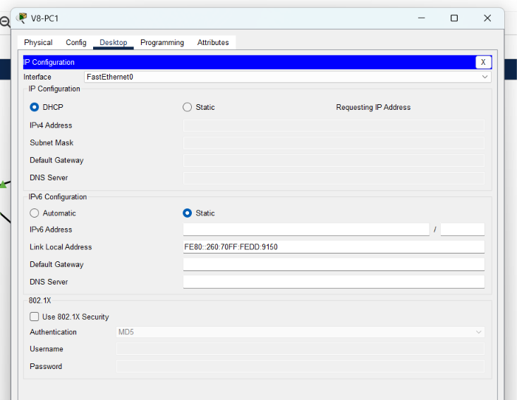
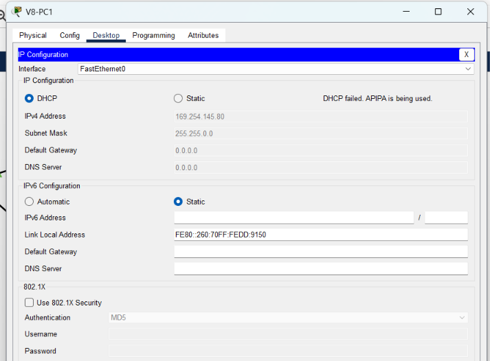
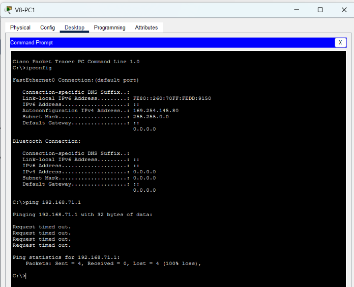
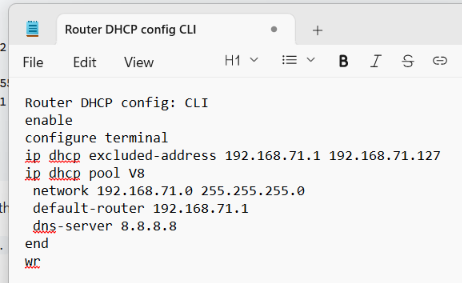
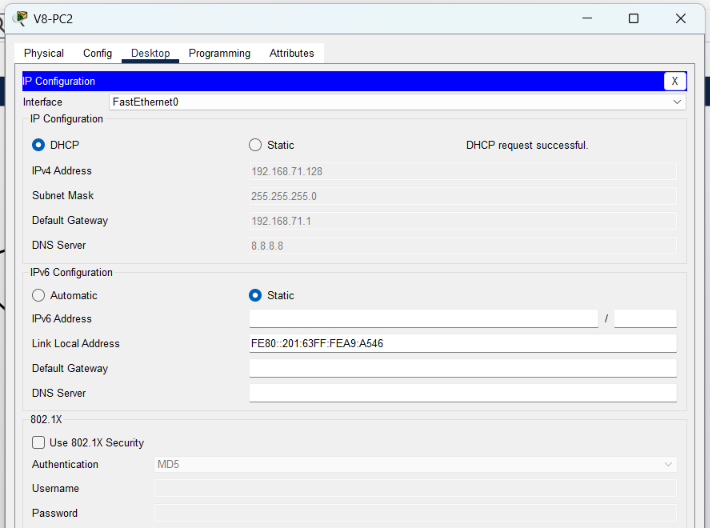
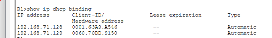
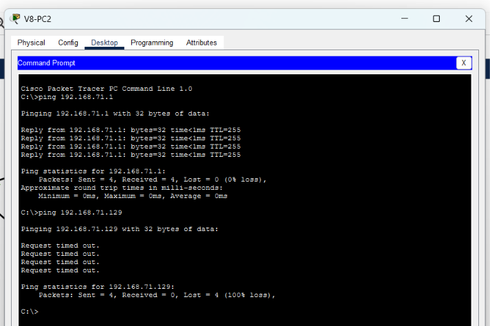
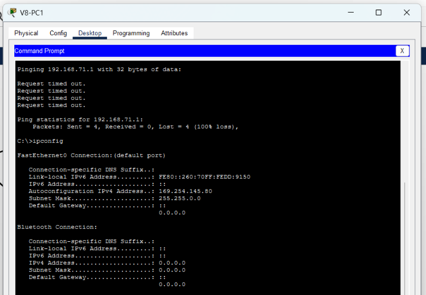
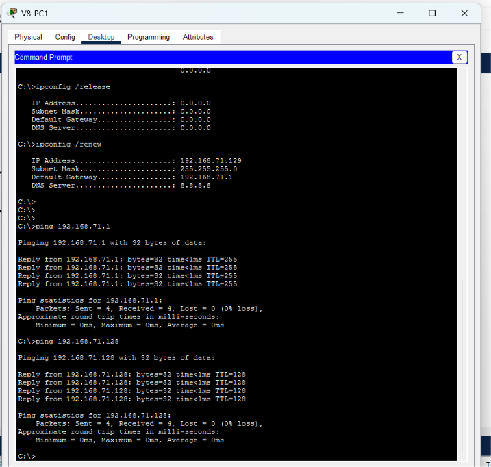
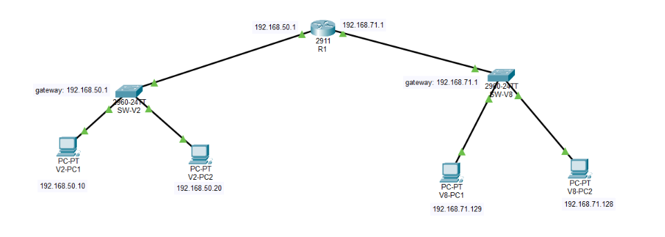

# Lab 4: DHCP (Dynamic Host Configuration Protocol)

> Network Fundamentals Lab Series | Tool: Cisco Packet Tracer | Devices: Cisco 2911 router (R1), two 2960 switches, four PCs

## Learning objectives
By the end of this lab you will be able to:
1. Describe what DHCP is and what it hands out to a client.
2. Explain what an **APIPA** address (`169.254.x.x`) is and why a PC gets one.
3. Configure a DHCP pool on a Cisco router.
4. Verify DHCP with `ipconfig` and `show ip dhcp binding`.
5. Explain each line of the router config.
6. Troubleshoot a client that is stuck on APIPA.

## Lesson plan (about 45 minutes)
| # | Step | Time |
|---|------|------|
| 1 | Describe DHCP | 5 min |
| 2 | Turn on DHCP on a PC and see the APIPA address | 5 min |
| 3 | Configure the router and show the results | 10 min |
| 4 | Explain the router config | 5 min |
| 5 | Work smarter: script your CLI and tests | 5 min |
| 6 | What breaks, and the fix | 10 min |
| 7 | What I learned and the final topology | 5 min |

## Starting topology
R1 (2911) connects to **SW-V2** (hosts on `192.168.50.x`) and **SW-V8** (hosts on `192.168.71.x`). This lab uses the V8 side: **V8-PC1** and **V8-PC2** will be DHCP clients and R1 will be the DHCP server.

---

## 1. Describe DHCP
DHCP automatically gives devices the network settings they need, so you don't type them in by hand:
- IP address
- Subnet mask
- Default gateway
- DNS server

The exchange has four steps, known as **DORA**: **D**iscover, **O**ffer, **R**equest, **A**cknowledge.

## 2. Configure DHCP on the PC and show the APIPA address
On **V8-PC1**, open *Desktop > IP Configuration* and select **DHCP**. The router has no pool yet, so nobody answers.



### What is APIPA?
**APIPA** (Automatic Private IP Addressing) is a fallback. When a PC set to DHCP gets no answer, it gives itself an address in `169.254.0.0/16`. It can only talk to other APIPA devices on the same link, so it can't reach a gateway or the internet.



`ipconfig` confirms it: the autoconfiguration address is `169.254.145.80`, the mask is `255.255.0.0`, there is no gateway, and `ping 192.168.71.1` fails with 100% loss.



> **Takeaway:** a `169.254.x.x` address means "the PC asked for DHCP and nobody answered."

## 3. Configure the router and show the results
On R1:
```
enable
configure terminal
ip dhcp excluded-address 192.168.71.1 192.168.71.127
ip dhcp pool V8
 network 192.168.71.0 255.255.255.0
 default-router 192.168.71.1
 dns-server 8.8.8.8
end
wr
```
This is the same config, written out in a text file before I pasted it into R1:



**V8-PC2** is set to DHCP and receives a full configuration:



On R1, `show ip dhcp binding` lists who got what:



| Client | IP address | Client ID / MAC |
|--------|-----------|-----------------|
| V8-PC2 | 192.168.71.128 | 0001.63A9.A546 |
| V8-PC1 | 192.168.71.129 | 0060.70DD.9150 |

## 4. Explain the router config
| Command | What it does |
|---------|--------------|
| `ip dhcp excluded-address 192.168.71.1 192.168.71.127` | Reserves these addresses so DHCP never hands them out (gateway, servers, static devices). The first address leased is therefore `.128`. |
| `ip dhcp pool V8` | Creates a pool named V8 and enters DHCP config mode. |
| `network 192.168.71.0 255.255.255.0` | The range the pool serves. |
| `default-router 192.168.71.1` | The gateway clients receive. |
| `dns-server 8.8.8.8` | The DNS server clients receive. |
| `wr` | Saves the config so it survives a reboot. |

## 5. Work smarter: write your CLI out first
Notice that I don't type the config into the router line by line. I write it out in a text file first, check it, and only then paste it in. That's why I explain every command in section 4: if you understand each line, you can edit it with confidence.

**Why this helps**
- **Automation:** when you need to configure several things (more pools, more VLANs, more routers), you reuse and tweak a script instead of retyping everything.
- **Fewer mistakes:** you fix typos and wrong addresses in a text file, where they cost nothing, not on a live device.
- **Repeatable:** if you break the lab, you rebuild it in seconds by pasting the same script.
- **Documented:** your script doubles as notes you can put on GitHub.

**The habit**
1. **Write** the commands out in a text file.
2. **Correct** them: check addresses, masks and names against your topology.
3. **Write the tests and the expected results** before you paste anything.
4. **Paste** it in, run the tests, and compare the real results to what you expected.
5. **Save** the working version as your template.

**Example test plan for this lab**
| Test | Where | Expected result |
|------|-------|-----------------|
| `ipconfig` | V8-PC1 / V8-PC2 | `192.168.71.128` or higher, mask `255.255.255.0`, gateway `192.168.71.1`, DNS `8.8.8.8` |
| `ping 192.168.71.1` | each PC | 4 replies, 0% loss |
| `ping` the other PC | each PC | 4 replies, 0% loss |
| `show ip dhcp binding` | R1 | One line per client with its MAC address |
| Possible failure: `169.254.x.x` | PC | DHCP didn't reach the PC. Check the pool, cabling and release/renew |

Practice this until it's second nature. Working smarter, not just harder, means you build the tools (scripts, test plans) that make every later lab faster.

## 6. What breaks, and the fix
**Symptom:** V8-PC2 can reach the gateway, but it can't reach V8-PC1.



**Root cause:** V8-PC1 is still on its APIPA address (`169.254.145.80`). It asked for DHCP before the pool existed, so it gave up and never picked up the new lease. It also can't reach the gateway.




**Fix:** release the stale address and request a new one.
```
ipconfig /release
ipconfig /renew
```
V8-PC1 now leases `192.168.71.129`, and both pings succeed: the gateway (`192.168.71.1`) and V8-PC2 (`192.168.71.128`).



### Quick troubleshooting checklist
1. Does the PC show `169.254.x.x`? DHCP didn't reach it.
2. Is the PC set to DHCP and cabled to the right switch port?
3. On the router, is the pool present, and do `network` and `default-router` match the LAN?
4. Is the excluded range too large, leaving no free addresses?
5. Run `ipconfig /release` then `ipconfig /renew`.
6. Check `show ip dhcp binding` on the router.

## 7. What I learned
- DHCP removes manual IP configuration.
- `169.254.x.x` is a reliable sign that DHCP failed.
- Excluded addresses keep the gateway and static devices safe.
- A PC that fails DHCP doesn't retry forever, so after fixing the server, run `ipconfig /release` and `/renew`.
- Verify from both sides: `ipconfig` on the PC and `show ip dhcp binding` on the router.
- Write your CLI and your tests out first. It saves time and makes automation possible.

## Final topology
R1 is the DHCP server for the V8 network. V8-PC1 and V8-PC2 are the DHCP clients, holding `192.168.71.129` and `192.168.71.128`. The V2 side keeps its static addresses.



---
*Part of my Network Fundamentals lab series. Feedback welcome.*