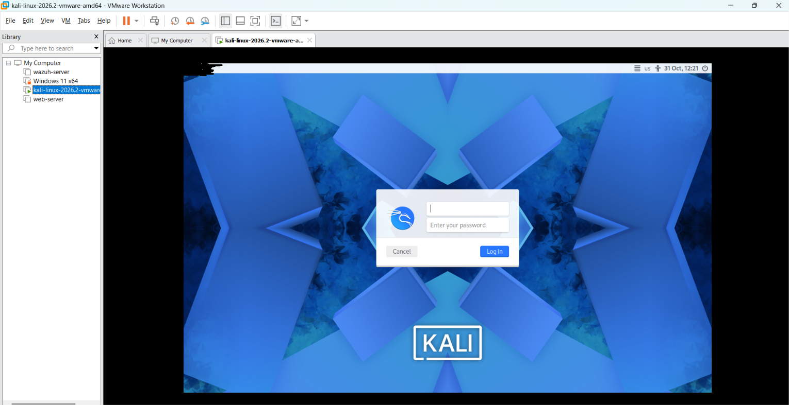
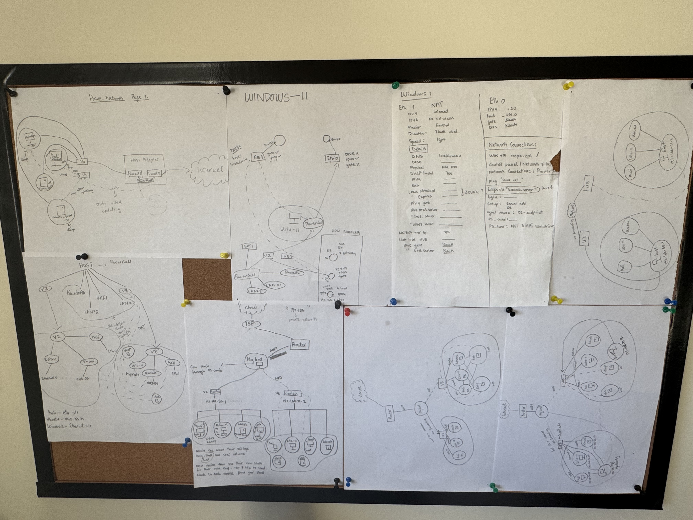
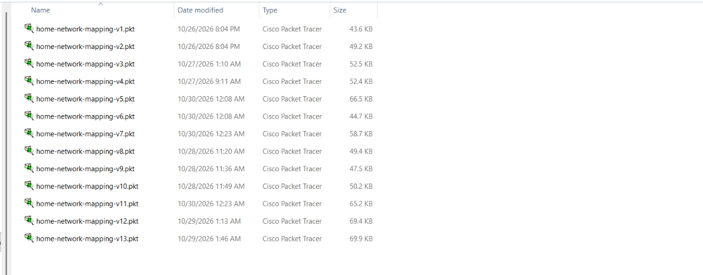
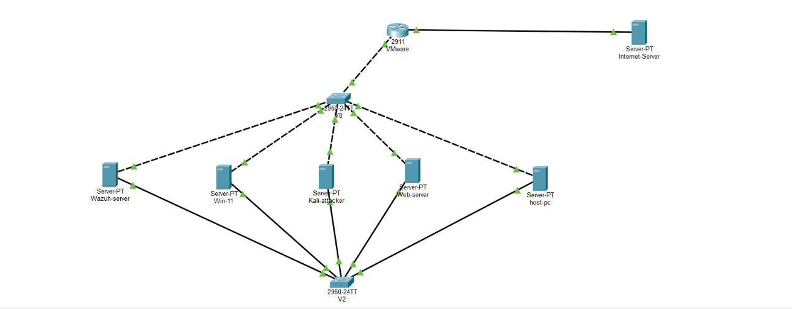

# Roadmap: How This Started

**Topic:** From network theory to hands-on practice
**Goal:** Map my own home lab network to understand it better.
**Why I did it:** I had read about networking and understood most of the theory, but I had never practiced it. My own lab was the closest real network I could test that understanding on.

## Step 1: The home lab
I built a lab in VMware Workstation with four machines: Kali Linux, Windows 11, a Wazuh server and a web server. Each one connects to two virtual networks. V2 is a closed network where the machines only talk to each other. V8 is a NAT network that gives them internet access.

## Step 2: Map it by hand
I drew the lab on paper to check that I really understood it. The drafts kept changing. That showed me that knowing the theory is not the same as being able to apply it.

## Step 3: Move to Packet Tracer
I found Cisco Packet Tracer and rebuilt the map there. It took 13 versions of the file to get it right.

## Step 4: The finished map
Every machine connects to both networks. The solid lines are V2 and the dotted lines are V8, which reaches the internet through the VMware router.

## What changed
Theory alone was not enough. Over a series of lessons I built networks that worked and networks that failed, and I broke them on purpose to find out why. Fixing each problem by working through the OSI layers showed me how deep networking really is. Every lesson in this repo comes from that process.

## What comes next
The home lab was the first goal. The next one is a small office network, planned and built from scratch: the planning, the addressing design, and the final build. I will share it once it is finished. The lessons in this repo are the steps toward it.

## Final topology
